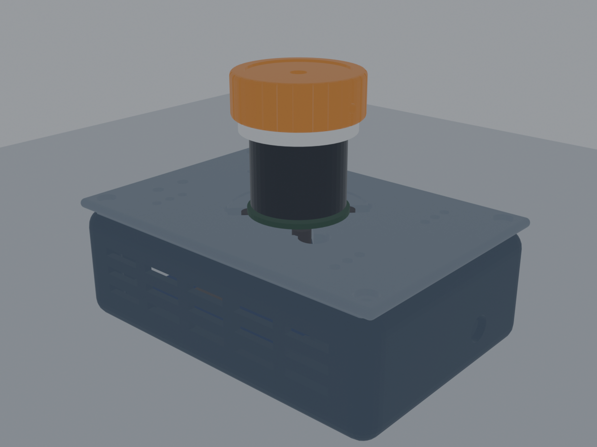

# AI-Agent-simpleFOC-Motor

用 **ESP32-S3 DevKitC-1 + DengFOC-Mini（MP6536 版）+ AS5600 + 云台无刷电机**，做一颗「用手扭开、松手立刻弹回原点」的触觉旋钮。

整个项目由对话式 AI 辅助从零搭建，包含：**可烧录固件**、**本地 Web 上位机**、**两套可 3D 打印的机械方案**（开放式台架 / Blender 参数化整机外壳），以及从接线、校准到排坑的完整文档。



## 已实现的效果

| 能力 | 说明 |
| --- | --- |
| 三步验证 | `STAGE 1` 验 AS5600 → `STAGE 2` 开环试转 → `STAGE 3` 闭环 FOC，每步只改一个宏 |
| 弹簧回中 | 默认 `M1`，手扭开松手即弹回上电原点；单环 PD + 原点死区，静止时完全不抖 |
| 静音刹车 | 速度环 `T0` 停止时绕开 PID 积分噪声，用纯阻尼电刹车滑停（`S1` 默认开启） |
| 实时调参 | 串口 `K/B/Z/H/G/J` 与上位机滑块都可热调，不用重新编译 |
| Web 上位机 | 零第三方依赖，实时角度 / Uq 曲线、圆盘指针、参数滑块、串口日志 |
| 机械件 | 5 个 STL 的开放式台架 + 3 个 STL 的整机外壳（含旋钮），全部水密可直接切片 |
| 一键烧录 | 附带 4MB 合并镜像与 `.bat` 脚本，无需打开 Arduino IDE |

## 硬件清单

- 主控：**ESP32-S3-DevKitC-1**（ESP32-S3-WROOM-1 模组，板载 GPIO48 WS2812）
- 驱动：**DengFOC-Mini / MP6536 版**（3PWM + EN，无主控，VIN 5~24V，5.5A 峰值）
- 传感器：**AS5600** 磁编码器（I²C 0x36），轴端径向充磁磁铁，气隙 1~3mm
- 电机：灯哥配套云台无刷电机（**7 对极**，相阻约 10Ω）
- 电源：**12V / 限流 1A**，VIN 端并联 470µF；ESP32 由原生 USB 口单独供电
- 其他：杜邦线、共地线、M3 螺钉螺母、AS5600 与板卡固定件

> ⚠️ 5.5A 是芯片内部逐周期**峰值**限流，不是可持续电流。相电流 ≈ `voltage_limit / 相阻`，换低阻电机前先量相阻并下调 `V_LIMIT`，详见 [安全边界](#安全边界)。

## 接线（S3 主方案）

| ESP32-S3 GPIO | 接往 | 备注 |
| --- | --- | --- |
| GPIO4 | DengFOC-Mini IN1 | 3PWM 相 A |
| GPIO5 | IN2 | 相 B |
| GPIO6 | IN3 | 相 C |
| GPIO7 | EN | 同时拉高 SHDNB / STBYB，**必须为高才有输出** |
| GPIO8 (SDA) | AS5600 SDA | S3 默认硬件 I²C |
| GPIO9 (SCL) | AS5600 SCL | |
| 3V3 | AS5600 VCC | 只接 3.3V，别接 5V |
| GND | 驱动板 GND + AS5600 GND | **必须共地** |
| VIN / GND | 外部 12V | 电机三相接 M1/M2/M3 |

S3 引脚禁区：`GPIO0/3/45/46`（strapping）、`19/20`（原生 USB）、`26~37`（Flash/PSRAM）、`43/44`（UART0）、`48`（板载 RGB）。本例用的 4~9 全是安全普通 GPIO。ESP32-C3 的接线**完全不同**，见 `docs/01-wiring.md`。

## 快速开始

### 1. 环境

- Arduino IDE 2.x + `esp32` 开发板包 3.x + **Simple FOC 2.4.0**
- 开发板选 `ESP32S3 Dev Module`；`USB CDC On Boot = Enabled`；`Upload Speed = 115200`
  命令行等价 FQBN：`esp32:esp32:esp32s3:CDCOnBoot=cdc,UploadSpeed=115200`
- 上位机：Python 3（仅标准库，Windows 原生串口 API，不需要 `pyserial`）
- 外壳重建：Blender 5.3（可选，STL 已生成好）

### 2. 烧录固件

两种方式二选一：

- **免编译**：双击 `ESP32S3_SimpleFOC_AS5600/flash_and_run.bat`，输入串口号，脚本会把 `ESP32S3_SimpleFOC_AS5600.merged.bin` 写到 `0x0`，并以 `--after watchdog-reset` 让程序真正跑起来。
- **自行编译**：用 Arduino IDE 打开同目录 `.ino`，按上面菜单设置后上传。

烧录前：**关闭 Arduino IDE 串口监视器、在上位机点「断开」**，释放串口；保持 12V 与三相线接好、**轴空转**，因为上电立即执行 `initFOC()` 对齐校准。

串口 115200 应看到：

```
MOT: Align sensor.
PP check: OK!
Motor ready.
HAPTIC READY (quiet). Twist the shaft by hand and let go -> snaps back.
```

`PP check` 若报 `estimated pp: N`，把 `.ino` 的 `POLE_PAIRS` 改成 N 重新编译。

### 3. 玩起来

- 默认 `M1`：用手扭动转盘，松手弹回原点，原点保持安静。
- 发 `M0` 切速度环，`T0.5` 慢速起转、`T0` 静音停止、`T2` 连续转；`L3` 设电压限幅。
- 手感太软 → `K12`；回弹过冲 → `B0.3`；原点还有细微抖动 → `Z0.03`；换个位置当原点 → `H`。
- 双击 `HapticConsole/start.bat`，浏览器打开 `http://127.0.0.1:8765`，用滑块实时调参并看角度 / Uq 曲线。

### 4. 装机械件

- **开放式台架**：`MountBracket/stl/` 5 个 STL，三块板 + 4 根 M3 长螺杆，AS5600 气隙靠螺母微调。
- **整机外壳**：`Enclosure/stl/` 3 个 STL（底盒 / 顶盖 / 滚花旋钮），`Enclosure/render/` 有装配、爆炸、内部三张渲染图。

两套方案互相独立，选一套打印即可。尺寸按标准值与实物照片估算，**打印前务必实测并改参数区**（`MountBracket/bracket.py` 顶部 / `Enclosure/enclosure.py` 的 `P` 字典），然后双击各自的 `regen.bat` 重新导出。

## 串口命令

行结束符 `\n`，波特率 115200。命令由 SimpleFOC `Commander` 解析，数值紧跟字母，如 `K8`、`Z0.012`。

| 命令 | 作用 |
| --- | --- |
| `T<值>` | `M0` 速度环时设目标速度 [rad/s]；`M1` 时设弹簧目标偏置 [rad] |
| `L<值>` | 电压限幅 [V]，上限被 `V_SUPPLY`/MP6536 安全范围约束 |
| `M1` / `M0` | 弹簧回中（默认） / 速度环 |
| `K<值>` | 弹簧刚度 Kp [V/rad]，默认 `8.0`，建议 4~12 |
| `B<值>` | 弹簧阻尼 Kd [V/(rad/s)]，默认 `0.20` |
| `Z<值>` | 原点死区 [rad]，默认 `0.012`（≈0.7°） |
| `H` | 把当前轴位置设为新原点 |
| `S1` / `S0` | 开启（默认）/ 关闭速度环零速静音刹车；`S0` 可复现原来的抖动 |
| `G<值>` | 静音刹车阻尼 [V/(rad/s)] |
| `J<值>` | 零速速度死区 [rad/s] |
| `D` | 打印诊断：`target / shaft / err / vel / Uq / Ua,Ub,Uc / AS5600 angle / GPIO duty` |

## 关键参数（`.ino` 顶部「只改这一区」）

```cpp
#define STAGE        3      // 1=传感器自检 2=开环 3=闭环FOC
#define POLE_PAIRS   7
#define V_SUPPLY     12.0f  // MP6536 版只允许 5~24V
#define V_LIMIT      3.0f   // 实测 1V 带不动、3V 才转
#define PHASE_R      10.0f  // 万用表量任意两相 ÷2
// 弹簧：Kp 8.0 / Kd 0.20 / 死区 0.012 / 速度低通 0.05s / 下采样 3
```

## 目录结构

```
.
├── ESP32S3_SimpleFOC_AS5600/   ★ 主固件（S3 + STAGE 3 + 弹簧回中 + 静音刹车）
│   ├── ESP32S3_SimpleFOC_AS5600.ino
│   ├── ESP32S3_SimpleFOC_AS5600.merged.bin   # 4MB 免编译镜像
│   ├── flash_and_run.bat / spin_test.ps1 / spin_test.bat
├── ESP32C3_SimpleFOC_AS5600/     C3 早期版本（历史存档，接线与 S3 不同）
├── ESP32S3_Blink/                点灯 / 串口 / 烧录链路的最小验证工程
├── HapticConsole/              ★ 本地 Web 上位机（server.py + index.html + start.bat）
├── MountBracket/                 开放式三板台架（bracket.py + 5 STL + 装配图）
├── Enclosure/                  ★ Blender 整机外壳（enclosure.py + .blend + 3 STL + 渲染）
├── docs/                         接线、固件、上位机、机械、排坑五篇文档
└── README.md / LICENSE / .gitignore / .gitattributes
```

各固件目录下的 `build/` 是 Arduino 编译中间产物（约 50~60MB），已忽略，可随时由 IDE 重建。

## 文档索引

| 文档 | 内容 |
| --- | --- |
| [01-wiring.md](docs/01-wiring.md) | S3 / C3 接线表、电源与共地、VCC 脚判别、MP6536 电气要点 |
| [02-firmware.md](docs/02-firmware.md) | 三个 STAGE、校准流程、弹簧回中与静音刹车的原理、命令与参数 |
| [03-console.md](docs/03-console.md) | 上位机启动、HTTP 接口、SSE 遥测、串口占用处理 |
| [04-mechanics.md](docs/04-mechanics.md) | 两套机械方案、STL 清单、参数区、五金 BOM 与打印建议 |
| [05-troubleshooting.md](docs/05-troubleshooting.md) | 实际踩过的坑与对应解法（CDC、错误 31、waiting for download、抖动等） |

## 安全边界

1. 12V 供电**限流 1A**，VIN 端并 470µF；`V_SUPPLY` 绝不超过 24V（代码有编译期检查）。
2. 相电流 ≈ `voltage_limit / 相阻`。10Ω 云台电机在 3V 下约 0.3A；换成 0.2Ω 航模电机时 1V 就是 5A，会直接撞 5.5A 限流报 FAULT。换电机先量相阻、从 0.5V 起。
3. FAULT 灯亮 = 过流 / 过温 / 欠压，**立刻断电**查相线与限幅，部分板需重新上电。
4. 上电 `initFOC()` 会正反微转做对齐，务必让轴空转；手扭住不放会堵转发热。
5. 重烧固件前先释放串口（关 IDE 监视器、上位机点「断开」）；长时间不用请断 12V。
6. 3D 打印件尺寸含按标准值/照片估算的部分，打印前实测电机、板卡、支撑柱与 USB-C 位置。

## 许可

[MIT](LICENSE) © 2026 Bruce Zhao

依赖：Arduino-ESP32、[SimpleFOC](https://github.com/simplefoc/Arduino-FOC)（按各自许可）；本项目未 vendor 第三方库源码，请用库管理器自行安装 **Simple FOC 2.4.0**。
